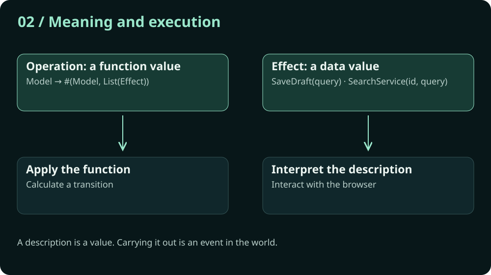
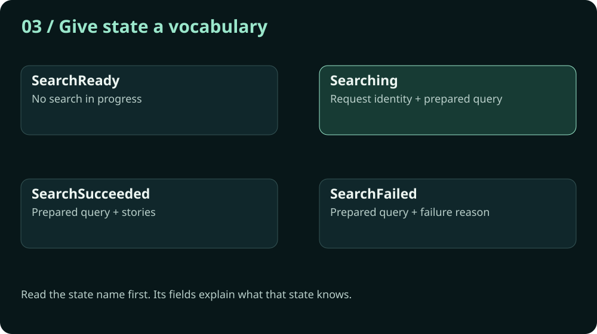
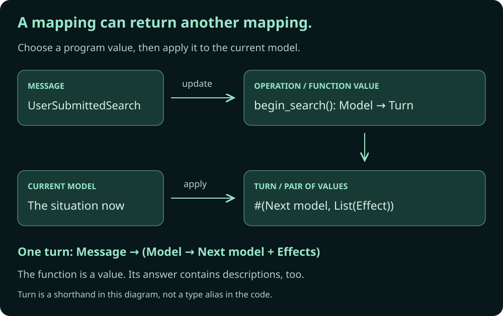
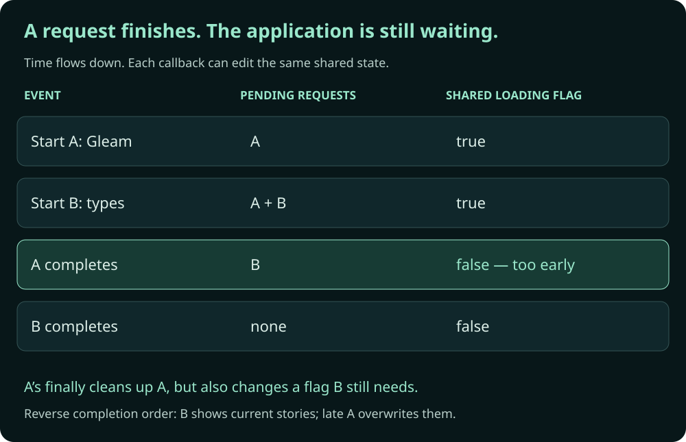
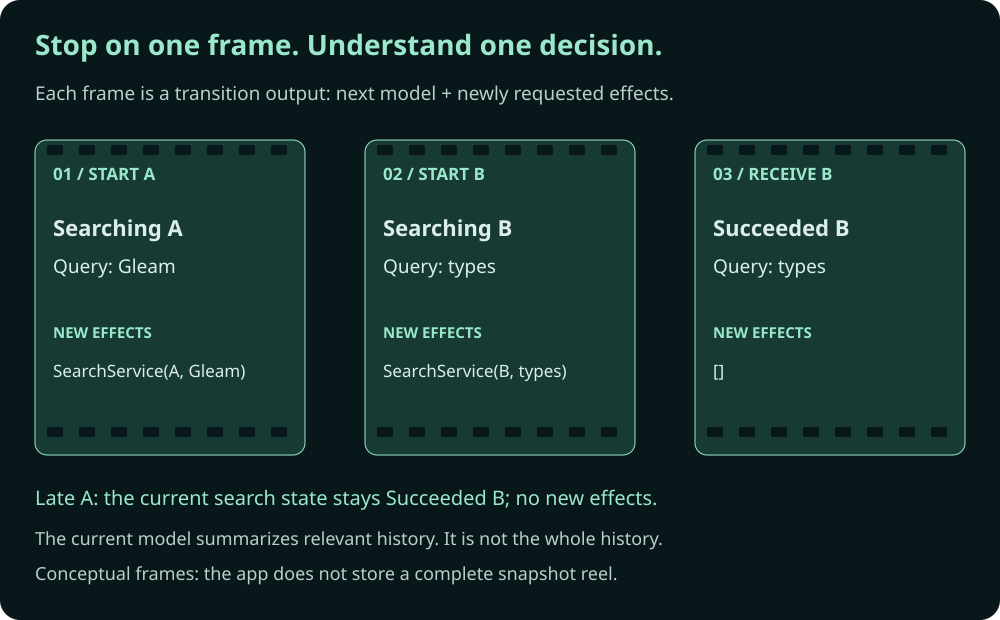
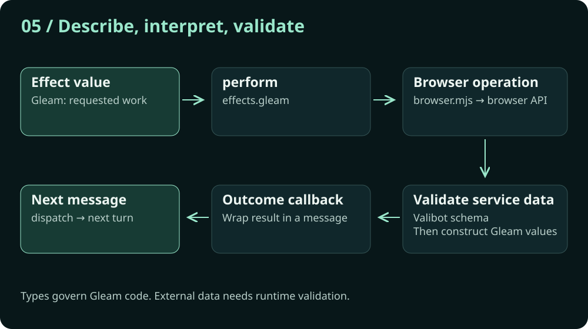
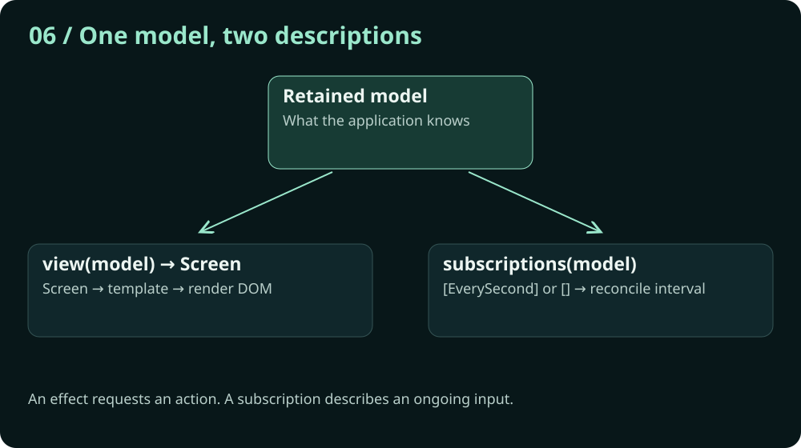
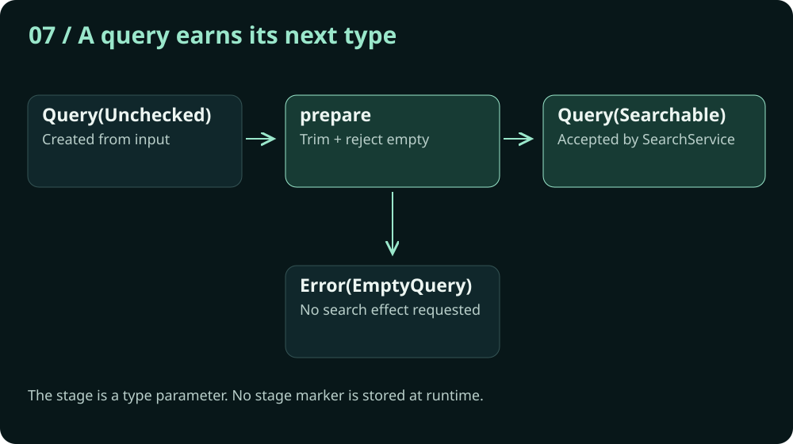

# The Value of Values

*How describing what happens can make an application easier to understand.*

An extended conference-talk draft about functional application design and Valuz, a small Gleam runtime for Model–View–Update applications. Read it as a guided exploration, with static visuals and code. We can refine its length after the ideas have room to develop.

[Try the app](/) · [Read the guide](guide.md) · [Keep the quick reference nearby](reference.md)

*Select any diagram to open it at full size. [Open the whole-app map](visuals/whole-app.svg) whenever you need your bearings.*

## 1. The problem is keeping the whole thing in your head

*Visual 1: The whole app*

[](visuals/whole-app.svg)

I want to start with a fairly ordinary programming problem. You open a project you haven't seen for a while. There is a model file, an update function, some rendering code, a browser adapter, and a collection of helpers. Every file makes sense when you read it. Somehow, the application doesn't.

You can understand the individual sentences without knowing what the conversation is about.

That is the problem I want to work on today. How do we make a program easier to approach? How do we make its structure visible enough that we can leave, come back two months later, and find our way around?

Our example is a small browser application. You can search Hacker News, save and restore a query, and start or stop a live clock. These features are deliberately modest. We need enough contact with the outside world to encounter real problems, while keeping the program small enough to examine.

Valuz is a small runtime for Model–View–Update applications. Browser Lab is the example we will explore. The larger exercise is functional application design: making application state, decisions, views, and requested effects explicit as values. Valuz gives those descriptions a small execution mechanism.

Here is the whole application on one picture. Something happens. We represent it as a message. That message selects an operation. The operation receives the current model and produces a new model alongside descriptions of requested work. A coordinator retains the new model and connects those descriptions to the browser. Results come back as more messages.

Keep that picture in mind. As we open each file, we’ll see where it fits in the application cycle.

We will spend most of the talk following a single search. By the end, you should be able to point at any part of the application and answer two questions: what decision belongs here, and what happens next?

The larger idea is that values can do more than hold the information our program happens to manipulate. Values can help us describe the program itself. They can give decisions, intentions, and transitions a form we can inspect before anything happens.

That sounds philosophical. Let's make it useful.

## 2. A program can be a value

*Visual 2: Meaning and execution*

[](visuals/values-and-execution.svg)

Let's start with a table.

| Input | Output |
|---|---|
| 1 | 2 |
| 2 | 4 |
| 3 | 6 |
| 4 | 8 |

We can represent these associations directly:

```js
const double = new Map([
  [1, 2],
  [2, 4],
  [3, 6],
  [4, 8],
])

double.get(3) // 6
```

Or describe the relationship with a rule:

```js
const double = number => number * 2

double(3) // 6
```

For the inputs in the table, the association is the same. One implementation stores the answers; the other calculates them when asked. The rule also describes answers for inputs we haven't written down.

This is the starting point of [What Is a Program, Really?](https://docklands-ssg.vercel.app/notes/what-is-a-program-really/): a pure function can be understood as a lookup table. We can describe a mapping without storing every entry. The meaning is the relationship between inputs and outputs; execution is how we obtain an answer.

A `Map` expresses that idea as a collection of associations. A pure function expresses it as a rule. We are interested in the mapping they describe, rather than the mechanics of looking up a key versus calling a function.

Now ask what can appear in the output column. A number? Certainly. A record? Of course. Another mapping?

Yes. A function can be the answer we look up.

That is more than the observation that a language lets us put a function in an array. The mapping itself is something we can choose, return, and combine. Composing two pure mappings gives us another mapping. A whole pure program, built by composition, is still a function value.

**A pure program is a value.**

Keep that claim in view. It will reappear in the application's code, where messages map to operations and operations map models to descriptions of the next turn. The lookup-table idea is going to do actual design work.

The browser introduces a complication. The same request may fail tomorrow. Reading the clock twice can produce different answers. Saving a query changes something outside the function. We cannot predict one fixed answer from a request alone.

In [And Then Somebody Opened a File](https://docklands-ssg.vercel.app/notes/and-then-somebody-opened-a-file/), we give the program a place for the world's answer. A request describes an interaction. A continuation maps the eventual result to the next program description. The result is unknown, but the relationship describing how to continue is already defined.

A request is a value. The continuation is a function value. Putting them together gives us another value: a description of a program that can interact with the world.

We don't need to enumerate every future response to define the relationship, just as we didn't need to store every row of the doubling table.

[Solving Problems with Values](https://docklands-ssg.vercel.app/notes/solving-problems-with-values/) brings that idea into an application: the world's answer arrives as a message, and the next pure decision maps the current model and that message to a new model and requested effects.

Those are the three steps behind this talk: a pure program is a value; an effectful program can have a value representation; and we can organize an application around those descriptions and mappings.

Carrying out a file write still changes a file. The value describes the program; an interpreter carries it out. That distinction lets us inspect and compose the description before the interaction occurs.

### You already make decisions this way

Imagine you're collecting a coffee. Your current situation includes a receipt for order 42 and the fact that you're waiting. Someone calls, “Order 42 is ready.” That is the message. Given that situation, you decide to collect it.

If they call order 17, you keep waiting. If you've already collected order 42, hearing its number again doesn't create another coffee. The same announcement can call for different behavior depending on your current situation.

You don't need to replay the barista's entire morning to make the decision. You don't need to know what the next customer will order. The receipt and your waiting state summarize the history that matters. The decision can give you a new intention and a new description of your situation: collecting order 42, with the action of walking to the counter still to carry out. Actual collection can later be confirmed as another event.

The pieces already have names we can recognize: a current situation, an announcement, a decision, and an action to carry out. We can describe the situation and intended action together before we execute the action. The order number tells us whether an announcement is relevant to us. Those are two different jobs, and both matter.

Keep order 42 in mind when we reach search requests. We are going to give this ordinary way of reasoning a precise vocabulary.

## 3. Give the application a vocabulary

*Visual 3: State with names*

[](visuals/search-states.svg)

Let's open [model.gleam](../src/app/model.gleam). This file establishes the language the application speaks. Just as the coffee example distinguished waiting for an order from collecting it, our search model names the situations that change how we respond to a message.

A search can be ready, in progress, successful, or failed. We give those alternatives names and attach the relevant information to each one:

```gleam
pub type SearchState {
  SearchReady
  Searching(request: SearchRequestId, query: SearchQuery)
  SearchSucceeded(query: SearchQuery, stories: List(Story))
  SearchFailed(query: SearchQuery, reason: FailureReason)
}
```

Compare that with a loading flag, an error string, a results list, and a few conventions we need to remember. Can loading and failed both be true? Does an empty results list mean we haven't searched, or that nothing matched? Does the error belong to the latest query?

The named alternatives answer some of those questions in the structure. A failed search contains its reason. A running search contains its request identity. Success carries the query that produced those stories.

This does not make every invalid condition impossible. Public constructors and foreign JavaScript still deserve attention. It does reduce the number of things the reader must infer from neighboring fields.

The same approach explains types such as `Clock` and `StorageState`. They belong to the example application's features. They are not requirements imposed on every application by Valuz. The clock demonstrates an ongoing subscription. Storage demonstrates immediate effect responses; search demonstrates asynchronous results.

That distinction helps when the model starts looking large. Some names describe the architecture. Other names describe the application we chose to build with it. We should be able to separate those responsibilities in our heads even when they share a file.

We also have names such as `SearchRequestId`, `Milliseconds`, and `StoryTitle`. These give primitive values a role. A duration and a request identifier may both contain an integer, but they are different things in the conversation.

Good names reduce translation. If I can read the model and recognize the concepts the application cares about, I have already learned something useful before studying a single algorithm.

The model becomes the vocabulary. Messages become the sentences.

## 4. A message chooses an operation

*Stay with Visual 1*

Open [domain.gleam](../src/app/domain.gleam). This is the application's table of intentions. Here is a shortened excerpt:

```gleam
case message {
  UserSubmittedSearch -> operations.begin_search()
  UserRequestedDraftSave -> operations.save_draft()
  UserRequestedTime -> operations.request_time()
  HttpReturnedSearchResult(request, result) ->
    operations.receive_search_result(request, result)
  // Other messages follow the same pattern.
}
```

### A mapping whose answers are programs

Look at the shape of this code. It looks remarkably like a `Map` from messages to operations, because conceptually that is the relationship it describes.

| Input message | Output operation value |
|---|---|
| `UserSubmittedSearch` | `operations.begin_search()` |
| `UserRequestedDraftSave` | `operations.save_draft()` |
| `UserRequestedTime` | `operations.request_time()` |
| `HttpReturnedSearchResult(request, result)` | `operations.receive_search_result(request, result)` |

[](visuals/mappings.svg)

The output column contains functions. `begin_search()` returns an operation waiting for a model; it doesn't start the HTTP request. `receive_search_result(request, result)` returns a function carrying those particular response values. A different message payload can select a different operation value.

Our `case` expression describes that mapping by cases. We don't need to replace it with a literal dictionary to recognize the relationship. The cases let us match message variants and use their payloads directly, with the compiler checking that we have covered them.

Now open one of the answers. An operation is another mapping:

```text
Message → Operation

Operation = Model → #(Model, List(Effect))
```

We have a mapping whose output is itself a mapping. Look up the operation for this message, then give that operation the current model:

```gleam
let operation = domain.update(message)
let #(next_model, effects) = operation(current_model)
```

That is one application turn expressed as a composition of relationships. The final answer contains ordinary values: a model and a list of effect descriptions. Nothing about choosing these answers requires a browser request to happen inside the decision.

This is the lookup-table argument appearing in application code. The table's answers don't have to stop at numbers or strings. They can be little programs. Connecting them gives us a larger program we can still treat as a value.

Read the first line aloud. The user submitted a search; begin the search. The name on the left describes what we observed. The name on the right describes the operation we choose in response.

That distinction is why the save message says `UserRequestedDraftSave`. The user clicking a button does not establish that storage accepted the write. A later message reports the result. Our vocabulary should preserve that uncertainty.

`Operation` gives a name to the function value in the output column:

```gleam
pub type Operation =
  fn(Model) -> #(Model, List(Effect))
```

That type names the second mapping we just followed. An operation waits for the current model and produces the next-model/effects pair. Its application calculates a description; performing the described effects remains a separate step.

We could put the transition logic directly in the message branches. Moving it into named operations gives the update table a particular purpose: it tells us what the application does in response to its messages. When we need the details, we follow the function.

That is a navigation aid, not a universal rule that every branch must move to another file. For this experiment, it makes a useful separation between choosing an operation and understanding how it calculates the next turn.

The update table directly returns the selected operation. This is enough: choose a mapping, then let the runtime apply it to the current model. We don't need to add bookkeeping to make that relationship visible.

## 5. Follow one search through the decision

*Visual 4: One search, two turns*

[](visuals/search-journey.svg)

Now open [operations.gleam](../src/app/operations.gleam). The user has typed a query and pressed Search. What should happen?

First, the operation prepares the draft query. Preparation trims whitespace and rejects an empty result. If preparation fails, the operation returns a ready search state and no effects. An empty query never becomes a request simply because the button was clicked.

If preparation succeeds, the operation constructs two related values. The next search state says that this request is in progress. The effect list asks the browser to search using the same request identity and prepared query. It also advances the counter for the next request.

Nothing has gone over the network yet. We have described the next turn. Why is that worth separating?

### The callback that belongs to yesterday

Here is a deliberately naive JavaScript implementation. Assume `render` updates the page. The example omits validation so we can concentrate on shared state and completion order.

```js
const state = { loading: false, stories: [], error: null }

function search(query) {
  state.loading = true
  state.error = null
  render(state)

  return fetch(`/api/search?q=${encodeURIComponent(query)}`)
    .then(response => {
      if (!response.ok) throw new Error(`HTTP ${response.status}`)
      return response.json()
    })
    .then(body => {
      state.stories = body.hits
    })
    .catch(error => {
      state.error = error.message
    })
    .finally(() => {
      state.loading = false
      render(state)
    })
}
```

Each line looks reasonable. Set loading when we start. Store the results when they arrive. Show an error if something fails. Turn off loading in `finally`, because either outcome has finished the request.

But which request?

I search for Gleam. Before that finishes, I search for types. Both calls now have callbacks that can mutate the same `state`. Each callback remembers its own request's completion, while the shared state represents an application that may have moved on.

[](visuals/loading-race.svg)

| Event | Work still pending | What the naive page now claims |
|---|---|---|
| Start A: Gleam | A | Loading |
| Start B: types | A and B | Loading |
| A completes; A's `finally` runs | B | Not loading, with A's stories |
| B completes | None | Not loading, with B's stories |

A's cleanup was correct about A and wrong about the application. The newer search is still running, but an older callback has turned off its loading indicator. An older error can similarly appear beneath the newer query.

Now reverse the completion order. Let B finish first, then A. B briefly shows the results we wanted. A arrives later and replaces them with yesterday's answer. We have a second bug: stale results overwrite current ones.

There is no simultaneous execution required. These callbacks can run one at a time on JavaScript's event loop. The race is over the order in which results arrive and which result is entitled to change the current application.

We can repair this JavaScript. Give each request an identity, retain the active identity, and check it before changing results, errors, or loading. Cancel obsolete requests where appropriate. Or model pending requests explicitly if the interface wants to track several of them. A shared Boolean on its own doesn't express any of those policies.

`finally` is still useful for releasing a resource owned by this request, such as its timeout. The problem is treating completion of one request as authority to change the lifecycle of another. In Valuz, the adapter clears its own timeout; the domain decides whether the outcome still belongs to the active search.

### Make relevance a decision we can inspect

The model remembers `Searching(request, query)`. The response operation receives the returned request identity and compares it with the active one. If they match, success or failure becomes the next search state. If they don't, the response leaves the domain state unchanged.

An obsolete result leaves the current search state unchanged and requests no effects. Relevance is an explicit application decision.

This is where the model-and-effect pair earns its keep. The decision that says “request 7 is now active” also returns the description “perform request 7.” There is a single result to inspect:

```gleam
#(
  // The full next model includes this search state:
  Model(..model, search_state: Searching(request, prepared)),
  // This is the work requested by that transition:
  [SearchService(request, prepared)],
)
```

This excerpt shows the relationship; the actual `begin_search` also advances the next request identity. Three responsibilities work together here:

| Responsibility | What it establishes |
|---|---|
| Return the next model and effects as a pair | The state we intend to retain and the work we intend to request can be inspected as one decision. |
| Check the returned request identity against the active one | An obsolete outcome cannot replace the current search state. |
| Retain the next model before performing effects; queue response messages | Even an immediate response is processed in a later turn against the retained model. |

The pair makes consistency visible. Identity establishes relevance. The coordinator preserves the order of turns. Returning a pair alone doesn't supply the stale-response policy: we could put mismatched identities in a perfectly well-typed pair. The operation must choose consistent values, and the response operation must check them.

This is the receipt at the coffee counter again. We decide what situation comes next and what to do, while the order number tells us which announcement belongs to that decision.

With these responsibilities in place, a future callback no longer gets to reach into a collection of fields and decide what “finished” means. It reports an outcome. A pure operation evaluates that outcome against the model that is current now.

### A reel of frames, rather than a tangle of edits

[](visuals/transition-frames.svg)

Think of a strip of film. Each frame gives us a coherent image at a particular point. Movement appears across a sequence of images, but we can stop the reel and examine one frame.

Our transition outputs are a little like those frames: a next model, together with descriptions of work requested on that turn. We can stop on a pair and ask whether it makes sense. Does the active request match the requested search? Does this state really call for a storage write? Did this message request any external work at all?

Effects in a frame describe new work requested at that turn; they are not a complete inventory of everything still in flight. The model must retain whatever ongoing obligations matter to the application. Also, “no effect” means no new external work was requested, not that the world has become idle.

The analogy has a useful limit. Our app does not store a complete reel of models. It retains the current model. The collapsible inspector shows that value without adding history to it. Complete snapshots or replay would be additional tooling. What we already have is a transition shape that makes those ideas possible to investigate.

To understand a transition, I need the current model and incoming message. I don't need to reconstruct every assignment that produced the model, or imagine which callbacks might eventually mutate it. Relevant history is summarized in the current value: the request identity, the submitted query, the clock mode. Future outcomes will be considered when their messages arrive.

We haven't abolished time. We have stopped asking the reader to mentally execute the whole timeline just to understand one decision.

### The test doesn't need a slow server

There are two different questions we can test here.

For the callback-driven implementation, we can replace fetch with controlled promises, then resolve B before A, or A while B is pending. We don't need wall-clock sleeps or a real slow server. We do need a way to control asynchronous completion, run the continuations, and inspect the shared state afterward.

For the pure domain policy, we supply the sequence directly: start A, start B, receive B's result, receive A's result. Each step is an ordinary function application. No mock requests, pending promises, or timer machinery is needed to check whether an obsolete result is ignored.

Both approaches can be deterministic. The difference is how much mechanism we must arrange to ask the policy question. We still test the browser adapter for timeout cleanup, decoding, and callback delivery. The pure transition test doesn't replace those responsibilities; it lets us examine the decision without bringing them along.

### Return to the coffee counter

Remember the receipt for order 42. Its identity was what made one ready announcement relevant and another irrelevant. Describing our next situation alongside our intended action made the decision coherent; it didn't make every announcement ours.

Now imagine describing this using a callback created when you paid: whenever any ready announcement arrives, set `waiting` to false and put the latest cup in your hand. Then, in `finally`, declare the queue finished. Whose cup? Whose queue? You would immediately ask which order the announcement belongs to and whether you're still waiting for it.

Those are the same questions our search operation asks. The program's vocabulary can match the way we already reason about an event in a situation. Messages, current context, and a decision are quite ordinary. It is the scattered mutation of shared facts from unrelated callbacks that makes the story hard to recognize.

## 6. Where the effects actually happen

*Visual 5: The boundary*

[](visuals/browser-boundary.svg)

Open [effects.gleam](../src/app/effects.gleam). This is the interpreter. It matches on an effect value and calls the appropriate browser adapter. A `SearchService` value becomes a call to the search function. A `SaveDraft` value becomes a storage write.

The interpreter supplies callbacks that translate browser outcomes into application messages. This is the continuation from the second article, expressed through our application loop: result → message → operation → next model and effects. A callback reports a value; the next turn applies the pure mapping that says what that value means. A search result becomes `HttpReturnedSearchResult`. A storage write becomes `StorageReturnedSaveResult`. The interpreter doesn't decide whether an old search result should replace a new one; we have already given that decision a home.

The browser mechanisms live in [browser.mjs](../src/app/browser.mjs). This is where we enter the trenches: the world of JavaScript, browser permissions, untrusted JSON, promises, and APIs that can throw before they even return a promise.

Gleam's compiler helped us describe the pure conversation. It cannot stand beside arbitrary JavaScript and verify every assumption we make there. A foreign-function declaration is a contract we must honor, not a force field around its implementation. JavaScript also has plenty of gotchas: losing a method's receiver, accepting a malformed object, or catching an application callback exception and reporting it as a second service failure.

So we push this dirty work toward the edge, keep it together, and make the individual pieces small enough that problems are easier to spot. The aim is to spend less time in the trenches when we're trying to understand the application’s decisions. We still have to inspect and test the boundary carefully.

This file knows about fetch, local storage, dates, and request timeouts. It validates the external search response and constructs the values expected by Gleam. A successful HTTP status doesn't establish that the response contains stories. JSON parsing doesn't establish that either. A Valibot schema checks the shape before we construct `Story` values.

At the same boundary, the URL helper accepts HTTP and HTTPS links and falls back to the story's discussion page for unsuitable URLs. Request resources, such as timeouts, are cleaned up here. Which returned request still matters is decided back in the domain.

The JavaScript is ordinary boundary code. Valibot validates responses, and a short async function handles fetch and timeout cleanup. A few local branches and try/catch blocks are easier to inspect here than another vocabulary of composed helpers. The application’s philosophy doesn't require every supporting expression to demonstrate it.

Here is the search entry point:

```js
export const search = (query, success, failure) =>
  fetchStories(query).then(success, error => failure(searchFailure(error)))
```

The architectural gain comes from containing this work and giving it an explicit contract. We can read the domain’s decision without following the browser mechanism.

There is a small detail in the promise chain worth preserving. Success and failure are sibling handlers. If application code throws while handling a successful response, that exception does not get reported as a second, failed network result. Our tests protect that distinction.

We still have real uncertainty: unavailable storage, malformed responses, and timeouts. The design gives those outcomes a route back into the application. It does not promise to prevent them.

## 7. The little machine that connects the pieces

> The [runtime contract](runtime-contract.md) examines the execution guarantees and the failure cases that this small coordinator does not yet resolve.

*Return to Visual 1*

The source layout makes the boundary visible: `src/valuz/` contains the reusable runtime; `src/app/` contains this application. `main.gleam` wires it together.

Now open [runtime.gleam](../src/valuz/runtime.gleam). If the previous files describe the conversation, this file keeps it moving.

The coordinator holds the current model and a queue of messages. For each message, it asks update for an operation, applies that operation to the current model, and receives the next model and effects. The center of the loop looks like this:

```gleam
let operation = config.update(message)
let #(next_model, effects) = operation(current.model)
write(state, State(..read(state), model: next_model))
publish(state, config)
perform_effects(state, config, effects)
```

These lines are an excerpt from the processing loop, not a standalone implementation. The order is the important part: calculate, retain, project, reconcile, perform. This is the coordinator’s part of the agreement we saw in the search example. The operation supplies a coherent pair, the response policy checks relevance, and this loop establishes when the next turn can observe the retained state.

Why retain the next model before performing an effect? Because an effect can report back immediately. Storage is synchronous in this implementation. If those results observed the previous model, our neat diagram would describe an ordering the application didn't actually follow.

The queue handles that case. A callback adds its message to the queue. A processing guard keeps it from starting a nested update while the current turn is still running. Once the current turn finishes, the next queued message gets its turn with the retained model.

The Gleam coordinator retains the current model, a queue, and processing and stop flags in one private reference. A small JavaScript helper supplies reference storage and `try/finally` cleanup; the queue and turn ordering are written in Gleam. It has no DOM element IDs, signals, interval handles, or application message constructors. `present`, `reconcile`, and `perform` are ordinary functions supplied by its host. The `observe` adapter offers a place for host-specific observation; this browser host supplies a no-op because its inspector is already part of the view.

[app.mjs](../src/app/app.mjs) keeps this application's browser wiring together: the existing HTML, DOM event handlers, the model inspector, and the live-clock interval. It supplies ordinary `present`, `observe`, and `reconcile` functions to the coordinator.

[view.mjs](../src/app/view.mjs) describes every panel as a template value using standalone [lit-html](https://lit.dev/docs/libraries/standalone-templates/). The markup and the events belong together. An input expression describes the displayed query; an event expression dispatches a message when someone edits it. The template includes the controls, result links, and current-model inspector.

The browser host connects this view language to our coordinator with two functions:

```js
// View and presenter functions supplied to Config:
model => appView(view(model), model, dispatch, actions),
description => render(description, root),
```

The inner `view` is our Gleam projection from model to `Screen`. `appView` turns that projection into a template value, including a formatted model for inspection. The coordinator receives a mapping from model to an interface description. It hands the description to `present`, and the renderer makes it visible.

This closes the gap we had when a `Screen` record was followed by a collection of handwritten DOM mutations. The interface description is now a value too. Constructing it doesn't update the page. It captures the display values and functions that report user interactions; rendering interprets that description.

The host also interprets `EverySecond` and starts or stops its interval. The coordinator doesn't know about clocks or document elements. We haven't adopted a second Model/Message/Update architecture to obtain a view language. The rendering library handles HTML updates; our own program still decides what happens next.

The Gleam coordinator and three JavaScript adapters have distinct jobs: `runtime.gleam` coordinates, `app.mjs` connects the browser, `view.mjs` describes the interface, and `browser.mjs` performs requested browser work. The boundary should make the application easier to understand, rather than become an application of its own.

For today, the mechanism is visible. There is no mysterious second application hiding beneath the application. There is a queue, a model, a few functions, and an explicit order.

## 8. The screen is another answer derived from values

*Visual 6: One model, two descriptions*

[](visuals/projections.svg)

Open [presentation.gleam](../src/app/presentation.gleam). The model contains application concepts. The screen needs words, links, and display choices. Presentation translates between them.

A failed search becomes a heading and a reason. A live clock mode becomes a “Stop live clock” label. The JavaScript template receives a screen description rather than independently interpreting domain states. It produces the interface value that the renderer interprets.

The story projection is another small mapping:

```gleam
list.map(stories, story_link)
```

Each `Story` becomes a `StoryLink` containing the title and URL the template needs. The collection holds domain values; presentation returns display values.

Presentation also describes subscriptions. When the clock mode is live, subscriptions returns `[EverySecond]`. When it is manual, it returns `[]`. The function does not start an interval. It states which ongoing input the current model wants.

The coordinator supplies that description to the subscription adapter. The adapter compares it with the interval it maintains and starts or stops the mechanism as needed. Clock ticks return as messages, just like search results.

A one-time effect says, “Do this.” A subscription says, “While this state calls for it, keep listening.” Both can have value descriptions, although they need different management over time.

This is why we included a clock in a search demonstration. It lets us ask whether the architecture can describe both a single request and an ongoing relationship with the environment.

The picture now has two more mappings:

```text
Model → Screen → TemplateResult
Model → List(Subscription)
```

Given a model, each selects its corresponding description. They belong to the same story as `Message → Operation`: we keep giving a value to a mapping and obtaining another value.

`story_link` maps one story to one display value; `list.map` carries that mapping across the list. The application uses both the general idea of mapping inputs to outputs and the familiar collection operation that applies a mapping to each element.

Rendering and maintaining an interval still do work. Deciding what to show and what to subscribe to are pure mappings we can inspect before that work happens.

## 9. Types can record what we have established

*Visual 7: A query earns its next type*

[](visuals/query-stages.svg)

One more file: [query.gleam](../src/app/query.gleam). It illustrates a way to make a relationship visible to the compiler as well as to the reader.

A draft query is unchecked. After preparation, it may be searchable. These are stages of the same opaque query type:

```gleam
pub opaque type Query(stage) {
  Query(String)
}

pub type Unchecked
pub type Searchable
```

The stage parameter is phantom. It appears in the type, but the stored value is just the query string. We don't construct an `Unchecked` object and attach it to the query.

`from_input` produces `Query(Unchecked)`. `prepare` trims that value and returns either an error or `Query(Searchable)`. The effect constructor for searching requires the searchable stage.

The constructor is private. That is what makes this more than a label someone can casually attach. Within checked Gleam code, callers need to go through the preparation API to obtain a searchable query.

This proves something specific: the query passed through this preparation rule. It does not prove that the server will accept it, that a network exists, or that a result will arrive. A type should tell the truth about what we have established.

We can explain the whole mechanism without asking the reader to learn a new runtime system. The types remember a step in the story that would otherwise live in a comment: prepare this before searching.

That is another use of values and types to lower the reader's memory burden. Instead of remembering an ordering convention everywhere, we give the relationship an explicit home.

## 10. How to find your way back into the app

*Return to Visual 1; keep this map nearby*

We have opened quite a few files. Let's turn that collection back into a map.

| Question | Start here | Follow next |
|---|---|---|
| What can the app know or receive? | [model.gleam](../src/app/model.gleam) | The relevant named state or message |
| What does this message mean? | [domain.gleam](../src/app/domain.gleam) | Its operation in [operations.gleam](../src/app/operations.gleam) |
| Why did this transition request work? | [operations.gleam](../src/app/operations.gleam) | The effect value it returns |
| How does that work reach the browser? | [effects.gleam](../src/app/effects.gleam) | Its adapter in [browser.mjs](../src/app/browser.mjs) |
| Who runs the next turn? | [runtime.gleam](../src/valuz/runtime.gleam) | The queue and dispatch loop |
| Why does the screen say that? | [presentation.gleam](../src/app/presentation.gleam) | Its `Screen` projection |
| Where are the parts connected? | [main.gleam](../src/main.gleam) | The functions supplied to `start` |

You don't need to begin by reading every file from top to bottom. Start with the kind of question you have.

If you are adding a feature, describe its conversation first. What can the user request? What information must the model retain? What effect could be needed? What message reports the outcome? Only then decide which browser API will carry it out.

### Add one small feature, and let the compiler point

Let's make the file map earn its place. Add a **Clear results** action. Its behavior is deliberately small: return search to `SearchReady`, keep the draft, and request no external work. If a search was pending, its later result should no longer repopulate the cleared view.

This is a walkthrough of a proposed extension, not a control currently added to the live app. The message and operation stages were checked in an isolated copy of the current Gleam source. The production source was left unchanged.

**First, add a message.** Inside `Message` in `model.gleam`, add:

```gleam
UserRequestedSearchClear
```

Build, before changing anything else. The compiler reports an inexhaustive case expression in `domain.gleam`. The diagnostic identifies the missing case:

```text
error: Inexhaustive patterns

The missing patterns are:

    model.UserRequestedSearchClear
```

The compiler has found the table where every message needs an operation. We didn't have to find every call site ourselves. The reminder comes from making the alternatives explicit.

**Next, define the operation and connect the message.** Add this function to `operations.gleam`, using the module's existing imports:

```gleam
pub fn clear_search() -> Operation {
  fn(model: model.Model) {
    #(Model(..model, search_state: SearchReady), [])
  }
}
```

Add this branch inside `domain.update`'s message case. Using the qualified constructor keeps the example independent of import-list edits:

```gleam
model.UserRequestedSearchClear -> operations.clear_search()
```

Build again. The Gleam build succeeds. No new effect is needed. The `Screen` type is unchanged because presentation already knows how to show `SearchReady`.

What about the late response? `receive_search_result` accepts a response only while the current state is `Searching` with a matching identity. Clearing changes the state to `SearchReady`, so the old outcome is ignored. The request isn't physically canceled; its eventual result simply has no authority to refill the view. A subsequent new search gets a fresh identity because we preserve the counter.

That explanation is a behavioral argument. The compiler can verify that the types and cases fit. It cannot prove that clearing is the product behavior we wanted. Tests for “keep the draft” and “ignore the old result after clearing” would still be worthwhile if we ship the feature.

**Finally, connect a control at the browser edge.** The typed action bundle in `main.gleam` would gain a field such as `clear_search: Message`, initialized with `model.UserRequestedSearchClear`. The template would gain a button with a message-producing event expression:

```js
html`<button @click=${() => dispatch(actions.clear_search)}>Clear results</button>`
```

Here is an honest boundary of the promise. Gleam checks its typed action bundle, but it doesn't inspect a handwritten JavaScript template and prove that its action field and message binding are correct. A browser check still matters. Adding a message alone doesn't create a control, and exhaustive pattern matching doesn't verify the entire application.

The compiler handles structural obligations. We handle intention and integration. Keeping that distinction visible makes the help more useful, because we know what it has actually established.

One design choice makes the assistance possible: the message cases enumerate their alternatives rather than hiding future messages behind `_ -> do_nothing`. A catch-all can be appropriate when ignoring a class of inputs is an explicit policy. At the message-routing boundary, it would surrender the reminder we just used.

The files are places to look, not steps to memorize. The journey through the system stays the same even when a feature touches several of them.

## 11. What is emerging, and what still needs work?

*Visual 2 again*

The application describes a set of relationships that Valuz coordinates: messages select pure operations, operations produce models and effect descriptions, presentation derives the screen and subscriptions, and a coordinator interprets those descriptions over time.

All this has happened before, and all this will happen again. [Elm](https://guide.elm-lang.org/architecture/) organizes interactive programs around model, view, and update. [Lustre](https://lustre.hexdocs.pm/) brings an Elm-inspired architecture and managed effects to Gleam. These are relatives worth acknowledging, not discoveries we should rename and pretend to have invented.

Valuz has a narrower job than a full application framework: coordinate the MVU cycle through supplied functions. Demystifying that cycle earns something even if we never publish a package. Understanding the cycle makes us better able to read those frameworks, use them deliberately, or implement the small part we actually need.

There is also a question of agency. We benefit from other people's work, but their next decision doesn't have to become our next decision automatically. Someone may change priorities, discover a different philosophy, or decide they'd rather farm in Denmark. If they do, I hope the harvest is excellent. They don't owe us the same project forever.

The concrete example of [fp-ts joining the Effect ecosystem](https://github.com/gcanti/fp-ts#readme) is a project describing its own evolution. That can be a thoughtful direction for its maintainers and users. It doesn't mean every existing user is ready to take the same step on the same day.

Large companies can change direction too. Financial backing and organizational size don't remove our need to understand what we've adopted. We can appreciate the people doing the work without making our understanding of our own application depend entirely on their continued choices.

The point is to empower ourselves to make decisions when we're ready: keep using a framework, migrate, maintain a small boundary ourselves, or explore a different approach. A visible mechanism gives us more informed choices. Building it once can be useful even when the eventual decision is to let a mature framework handle it.

We should also be honest about the present implementation. The model includes this application's example features. The browser view describes this app’s HTML templates, while the coordinator is independent of that rendering choice. The subscription manager handles the clock. There is no general cancellation system, persistent history, or replay tool hidden behind the model inspector.

The model inspector shows current state. Its formatter includes constructor names, making a switch from `ManualClock` to `LiveClock` visible even though neither variant has a payload. It stores no history. Recording or replay would require a deliberate contract for external outcomes, initial conditions, and interpretation choices.

Tests already benefit from the separation. We can test pure decisions directly and exercise browser adapters with controlled responses. We can check that storage failure reports once, that stale search results are ignored, and that callback bugs aren't misreported as external failures.

Those are concrete benefits today. Generalizing the runtime and packaging a reusable API should be driven by additional applications. Otherwise we risk building a framework around the accidental shape of one demonstration.

The question for this small runtime is whether its contract continues to help as the application changes. We now have boundaries clear enough to investigate.

## 12. The value of values

*Visual 1, one last time*

We began with a project whose files were individually understandable and collectively difficult to hold in mind.

Our answer was to give the conversation a visible shape: a current situation, an incoming message, and a coherent next model-and-effects pair. A message says what happened. An operation says how the application responds. A model says what it currently knows. An effect says what work it requests. A screen says what to show. A subscription says what to keep listening for.

Return to the table we started with. We gave it an input and found its corresponding output. Then we allowed the output to be another mapping. Now we have an application built from that idea:

| Mapping | What its answer describes |
|---|---|
| Message → Operation | The program to apply for this event |
| Model → Next model and effects | What to remember and what work to request |
| Model → Screen | What to show |
| Model → Subscriptions | What to keep listening for |

These function values and data values form the application's description. In `main.gleam`, we hand the update, view, subscription, and effect-handling functions to a coordinator as values. The coordinator uses them to carry the conversation forward. Some functions describe pure decisions; others interpret the descriptions at the edge. Their roles remain visible even though all can be passed as values.

This does not remove every hard problem. The browser still has permissions. Networks still fail. Requests still race. We still need to understand the coordinator, and we still have to choose good models. The advantage is that those concerns have places to live and routes by which they meet. The pair lets us inspect consistency; request identity lets us decide relevance; the coordinator gives each message a turn in a defined order.

That changes how we read. We can ask what should happen without immediately studying how fetch works. We can inspect the requested effect without performing it. We can test an awkward sequence of outcomes without arranging an awkward real-world situation.

And it changes how we return. After a month away, we have a map: vocabulary, decisions, descriptions, interpretation, outcomes. We can find the next relevant piece rather than rebuild the whole application in our heads. Like stopping a film on one frame, we can inspect one decision without mentally playing every callback that came before it or might follow it.

A pure program is a value: a mapping we can describe and compose. An effectful program can have a value representation too: requests together with mappings that determine how to continue from the world's answers. In this application, result messages and the next call to update provide that continuation.

The browser makes the interactions real. It doesn't have to invent the program's decisions while doing so. We have already described the relationships that tell us how to continue.

**The program is something we can describe as a value. Execution is what happens when we interpret it.**

That is the ambition of Valuz. Make the program's meaning easier to see. Keep the mechanism understandable. Let the next step follow from a description we can read.

We wanted programming to be easier. Values give us something concrete to work with.

---

*For a second pass: open the [full guide](guide.md), choose one control in the [app](/), and follow its message around the whole-app diagram. The [quick reference](reference.md) is the file map you can keep beside the source.*
